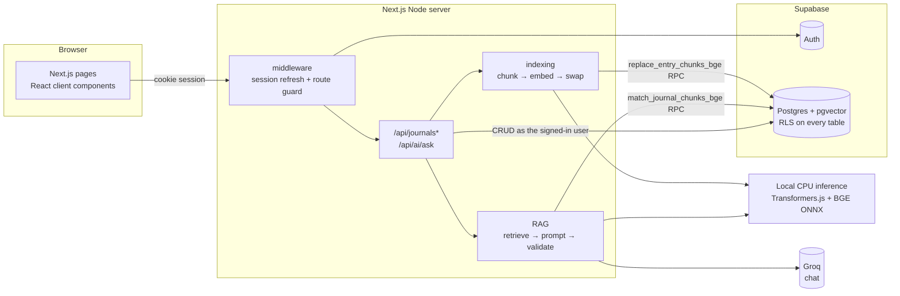

# ReflectAI — a private AI journal with RAG

ReflectAI is a multi-user journal. You write entries, then ask questions in plain language
("How did my interviews go?", "What have I been learning lately?"). Answers come **only
from your own entries**, and every claim links back to the entry it came from.

**Repository:** [Samarthsalvade/reflect-ai](https://github.com/Samarthsalvade/reflect-ai)

Built for the Personalized AI Journal (RAG MVP) assignment.

---

## Features

- **Email/password auth** (Supabase Auth): sign up, sign in, sign out, protected routes, durable cookie session.
- **Journal CRUD**: create, read, edit and delete entries with a title, date and body.
- **Automatic indexing**: each save chunks the entry, embeds the chunks locally with Transformers.js and stores the vectors in pgvector. A status badge shows *Indexed / Indexing / Not indexed*, and there's a one-click retry.
- **Ask my journal (RAG)**: the question is embedded, the most similar chunks are retrieved *for this user only*, and a chat model answers from those chunks alone.
- **Clickable citations**: inline `[S1]` markers and source cards open the entry with the cited passage highlighted.
- **No made-up answers**: if nothing relevant is found, you get an "insufficient journal evidence" reply instead of generic advice.
- **Strict multi-tenancy**: Row Level Security on every table, `SECURITY INVOKER` database functions, and no service-role key anywhere in the app.
- **Cost control**: a per-user hourly cap on AI questions.
- Responsive on phone and desktop, follows the system light/dark setting, and the forms are keyboard- and screen-reader-friendly.

## Architecture



The app is one Next.js App Router project. The server routes are a thin layer that coordinates the work.
Every database call uses the **signed-in user's own session**, so Postgres RLS decides what
each request can see. The Groq key exists only on the server. Embedding text stays on the app server; no embedding API key is needed.

### Workflow A — saving an entry

1. The server verifies the session (`supabase.auth.getUser()`) and validates the payload with Zod.
2. The entry is written to `journal_entries`. `user_id` comes from `auth.uid()` in the database, never from the browser.
3. The text is split into overlapping chunks: ~1,000 characters each with ~150 characters of overlap, on sentence boundaries.
4. Each chunk is embedded with `BAAI/bge-small-en-v1.5` (384 dimensions). The title and date are prepended so questions about dates and topics match.
5. `replace_entry_chunks_bge()` deletes the old vectors and inserts the new ones **in one transaction**, and only if the entry hasn't been edited again in the meantime (an optimistic version check on `updated_at`).
   If local inference fails, nothing is deleted. The last working index stays in place (retrieval excludes it if the entry text has changed) and the entry is marked `failed` so it can be retried.

### Workflow B — asking a question

1. The server checks the session and the per-user quota (`consume_ai_quota()`).
2. The question is embedded with the same model, with BGE’s query instruction prefix; document chunks receive no query prefix.
3. `match_journal_chunks_bge()` runs a cosine-similarity search **scoped to `auth.uid()`**, keeps chunks above a threshold, and returns the top-k (default 5) with title, date and entry ID.
4. If nothing qualifies, the server returns *insufficient evidence* without calling the chat model.
5. Otherwise the chunks are labelled `S1…Sn` and sent to `openai/gpt-oss-20b` with strict instructions: answer only from the excerpts, cite every claim, and say so if the excerpts don't answer the question. The reply is JSON.
6. The server **validates the citations**. Labels that weren't retrieved are dropped, and an answer with no valid citation becomes *insufficient evidence*. The client receives the answer plus source cards that link to the entries.

All journal entries are never sent to the model in bulk. Only the retrieved chunks are.

## Tech stack

| Layer | Choice | Why |
|---|---|---|
| Frontend + backend | Next.js 15 (App Router), TypeScript, React 19 | One deployable app; server routes keep secrets off the client |
| Styling | Tailwind CSS v4, lucide-react icons | Fast, consistent, responsive |
| Auth + DB | Supabase Auth + PostgreSQL | Managed auth, SQL migrations, Row Level Security |
| Vectors | pgvector on the same Postgres | Vectors sit next to the rows they index; one security model covers both |
| AI | Local Transformers.js `Xenova/bge-small-en-v1.5` + Groq `openai/gpt-oss-20b` | Free local embeddings; small model is enough for grounded answers |
| Validation | Zod | Request shape and length limits on every endpoint |
| Tests | Vitest | Unit tests for chunking/citations; integration tests for RLS |
| Hosting | Vercel | Native Next.js deployment and environment config |

## Project structure

```
app/
  (auth)/login, (auth)/signup, (auth)/actions.ts   server actions for sign in/up/out
  (dashboard)/dashboard                           entry list
  (dashboard)/journal/new, journal/[id]           create / view / edit / delete
  (dashboard)/ask-ai                              Ask my journal
  api/journals, api/journals/[id], [id]/reindex   CRUD + retry indexing
  api/ai/ask                                      RAG endpoint
  auth/confirm                                    email-confirmation callback
components/  auth/, journal/, chat/
lib/
  ai/        chunking.ts embeddings.ts retrieval.ts rag.ts citations.ts groq.ts local-embeddings.ts
  journal/   schema.ts (Zod + types), indexing.ts
  supabase/  server.ts client.ts middleware.ts
  api/http.ts                                     auth guard, JSON + error helpers
supabase/migrations/001_initial.sql               tables, RLS, RPCs, grants
scripts/seed-demo.ts                              fictional demo data for two accounts
tests/unit, tests/integration
```

## Setup

### Prerequisites

- Node.js 24 LTS (including the test runner)
- A Supabase project (the free tier is fine)
- A Groq API key; no Hugging Face token or hosted inference subscription

### 1. Install

```bash
git clone https://github.com/Samarthsalvade/reflect-ai.git
cd reflect-ai
nvm use                       # Node 24; install it with nvm install if needed
npm ci
cp .env.example .env.local     # fresh clone only; do not overwrite an existing file
# Fill in Supabase URL, publishable key, and Groq API key.
npm run check:env
```

### 2. Environment variables

| Variable | Required | Where it's used | Notes |
|---|---|---|---|
| `NEXT_PUBLIC_SUPABASE_URL` | ✓ | browser + server | Supabase → Project Settings → API |
| `NEXT_PUBLIC_SUPABASE_PUBLISHABLE_KEY` | ✓ | browser + server | The publishable key (`sb_publishable_…`) or the legacy `anon` key. Safe to expose because RLS protects the data |
| `GROQ_API_KEY` | ✓ | server only | Never prefix with `NEXT_PUBLIC_` |
| `GROQ_CHAT_MODEL` | | server | Default `openai/gpt-oss-20b` |
| `TRANSFORMERS_CACHE` | | server | Writable download cache; default `.cache/transformers` |
| `AI_ASK_LIMIT_PER_HOUR` | | server | Default `30` questions per user per hour |
| `RAG_MATCH_THRESHOLD` | | server | Default `0.65` (tune against your own relevant/unrelated questions) cosine similarity |
| `RAG_MATCH_COUNT` | | server | Default `5` chunks (capped at 10 in SQL) |
| `TEST_USER_A_*`, `TEST_USER_B_*` | | seed + integration tests | Two throwaway accounts you create in the app |

The app never needs the Supabase **service-role** key. Don't add it.

### 3. Supabase

1. Create a project at [supabase.com](https://supabase.com).
2. For a **fresh database**, open **SQL Editor**, paste in [`supabase/migrations/001_initial.sql`](supabase/migrations/001_initial.sql) and run it. It enables `vector`, then creates the tables, RLS policies, functions and grants.
   Then apply `supabase/migrations/002_huggingface_bge.sql`. Existing databases need **only 002**; never rerun 001.
   (With the Supabase CLI: `supabase link` then `supabase db push`.)
3. **Authentication → Sign In / Providers → Email**: keep it enabled. Then either:
   - turn **Confirm email** off for a quick demo, or
   - leave it on and add `http://localhost:3000/auth/confirm` and `https://<your-domain>/auth/confirm` under **Authentication → URL Configuration → Redirect URLs**.
4. Copy the project URL and publishable key into `.env.local`.

### 4. Run

```bash
npm run dev            # Turbopack development server, http://localhost:3000
```

Optional demo data (fictional entries for two accounts):

```bash
# create two accounts in the app first, put their credentials in TEST_USER_A_* / TEST_USER_B_*
npm run seed
```

## API

All endpoints require a signed-in session cookie. Request bodies are JSON (`Content-Type: application/json` is enforced).

| Method | Endpoint | Does |
|---|---|---|
| `GET` | `/api/journals` | List the user's entries (newest first) |
| `POST` | `/api/journals` | Create `{ title, content, entry_date }` and index it → `201 { entry, indexing }` |
| `GET` | `/api/journals/:id` | Read one entry |
| `PATCH` | `/api/journals/:id` | Update any field and re-index → `{ entry, indexing }` |
| `DELETE` | `/api/journals/:id` | Delete the entry; its chunks cascade |
| `POST` | `/api/journals/:id/reindex` | Retry indexing after a failure |
| `POST` | `/api/ai/ask` | `{ question }` → `{ answer, sources[], grounded, retrievedCount }` |

| Status | Meaning |
|---|---|
| `400` | Validation failed (`details` lists the fields) |
| `401` | Not signed in |
| `404` | Entry doesn't exist **or belongs to someone else**. These are deliberately indistinguishable |
| `415` | Body isn't JSON |
| `429` | Hourly AI question limit reached |
| `502` | AI provider unavailable. Stored entries are unaffected |

`indexing.status` is `ready`, `pending` (a newer edit is being indexed) or `failed`. A failed index still saves the entry.

## Authorization model

- **Identity** comes only from the verified Supabase session. The server never reads a `user_id` from the request.
- **RLS** is enabled on `journal_entries`, `journal_chunks_bge` and `ai_requests`:
  - Entries: `SELECT/INSERT/UPDATE/DELETE` only where `auth.uid() = user_id`.
  - Chunks: readable and insertable only if the chunk's `user_id` **and** its parent entry's owner are `auth.uid()`. There's no update policy; chunks are only ever replaced.
  - A trigger stops `user_id` from ever being changed on update.
- **Functions** (`match_journal_chunks_bge`, `replace_entry_chunks_bge`, `consume_ai_quota`) are `SECURITY INVOKER` with an empty `search_path`. They run with the caller's rights, so RLS still applies, and they also filter on `auth.uid()` explicitly as a second check. `EXECUTE` is revoked from `anon`.
- **No service-role key** exists in the app, so no code path can bypass RLS.
- **CSRF**: mutating API routes require `application/json`, and Supabase cookies are `SameSite=Lax`.
- **Open redirects**: the `?next=` parameter on login is restricted to same-site relative paths.
- **Prompt injection**: excerpts are fenced and declared as data. Citations are validated server-side, so the model can't cite entries that weren't retrieved.

## Testing

```bash
npm test                    # unit: chunking + citation validation (no network)
npm run test:integration    # RLS / RPC isolation against your Supabase project
npm run typecheck
npm run build
```

The **integration suite** signs in as two real accounts and proves that:

- account B can't read, update or delete account A's entry by ID, or read its chunks;
- B's similarity search doesn't return A's chunk, even with an identical query vector;
- B can't write chunks into A's entry (neither via the RPC nor a direct insert);
- anonymous callers get nothing;
- re-indexing replaces the old vectors, superseded vectors disappear from search, and a stale embedding job can't overwrite a newer index;
- deleting an entry removes its vectors.

It uses synthetic vectors, so it needs no AI provider key and the similarity scores are deterministic.

### Manual QA checklist

| Scenario | Expected |
|---|---|
| Sign up / in / out | Session starts and ends; `/dashboard` redirects to `/login` when signed out |
| Create, edit, delete | Changes persist across refresh; delete removes vectors |
| Grounded question | Answer cites `[S#]` and the source cards open the right entry with the passage highlighted |
| Unrelated question ("What's the capital of Peru?") | "I couldn't find anything in your journal…" |
| Cross-account ID (paste A's `/journal/<id>` while signed in as B) | "Entry not found" |
| Cross-account search (B asks "What do you know about Project Atlas?") | No evidence; A's secret isn't revealed |
| Edit then ask | New facts are found; removed facts aren't |
| Unavailable model download / unwritable cache | Entry saves with a *Not indexed* badge and a retry button; Ask shows a friendly error |

## Deployment

Local embeddings require a Node.js runtime with native ONNX support, sufficient memory, and a writable model cache. A persistent Node server is the simplest deployment. Vercel deployments must be checked against native binary/model size and cold-start limits; the previous hosted-inference deployment assumptions no longer apply.

### Vercel configuration (subject to those limits)

1. Push this repo to GitHub and import it in Vercel. The framework (Next.js) is auto-detected.
2. Add the environment variables from `.env.example` under **Settings → Environment Variables** (Production and Preview).
3. Deploy, then add `https://<your-app>.vercel.app/auth/confirm` to Supabase's redirect URLs and set it as the **Site URL**.
4. Smoke test on the live URL: sign up → create an entry → ask a question → open a citation → sign in as a second account and confirm the first account's data can't be seen.

`/api/ai/ask` sets `maxDuration = 60`. Indexing runs inline within the request. Warm the model first and measure latency on your host; a cold model download can exceed request timeouts.

## Known trade-offs and next steps

- **Exact vector search, no ANN index.** Retrieval filters by `user_id` with a B-tree and then ranks exactly. At journal scale (hundreds or thousands of chunks per user) this is fast and avoids HNSW's post-filtering, which can silently drop results in multi-tenant tables. With a very large corpus, add an HNSW index and pgvector 0.8's iterative scans.
- **Indexing is synchronous.** It's simple and reliable for an MVP. A queue (Supabase Queues, Inngest) would make saves instant and retries automatic.
- **Character-based chunk sizing** (≈4 chars per token) avoids a tokenizer dependency. Swap in `tiktoken` if you need exact token counts.
- **The quota check isn't strictly atomic.** Truly concurrent requests can exceed the cap by a request or two. That's acceptable for a cost guard.
- **Chat history isn't persisted.** Q&A lives only in the current page session.
- **Not yet built:** OAuth providers, tags, mood analytics, streaming answers, hybrid (keyword + vector) search, and a reranking step.
- `npm audit` flags the PostCSS copy that Next 15 bundles for **build-time** CSS processing. It isn't reachable at runtime. The fix is Next 16.

### Troubleshooting signup “fetch failed”

This means the Next.js server could not reach Supabase; it is not necessarily an
invalid password or an unapplied migration. Check the project URL and publishable
key in `.env.local` against the same project's Connect/API settings, and restart
Next.js after any environment changes. Never use a secret/service-role key in a
`NEXT_PUBLIC_` variable.

If ordinary sites load but Supabase resets the connection, compare the project's
DNS result with a trusted encrypted DNS resolver. Network DNS filtering can return
an incorrect address even when requesting a public resolver over ordinary DNS.
Try another network (for example, a mobile hotspot), or ask the network provider
to resolve the filtering. Do not hard-code CDN IP addresses or disable TLS checks.
Browser-only Secure DNS does not fix server-side requests made by Next.js.

With confirmation enabled, set Authentication → URL Configuration → Site URL to
`http://localhost:3000` for local development and allow
`http://localhost:3000/auth/confirm` in Redirect URLs. Keep production URLs when
sharing a project with a deployed app. The callback supports Supabase PKCE `code`
and `token_hash` confirmation links. Use an email inbox you control. Supabase's
built-in mail service restricts recipients; configure custom SMTP for other users.

Apply `supabase/migrations/001_initial.sql` only to a fresh database. It contains
plain CREATE TABLE statements and must not be rerun blindly over existing tables.
A successful anonymous empty-table query confirms API visibility, not that all
RLS policies and RPC definitions match the migration. Run the existing integration
suite with two configured test users to validate isolation after setup.

## Upgrading an existing OpenAI installation

1. Stop the local app (and pause writes from any deployed copy). Take a normal Supabase backup.
2. Run **only** `supabase/migrations/002_huggingface_bge.sql` once in Supabase SQL Editor,
   or use the CLI migration workflow if 001 is already recorded in migration history.
   The transaction creates `journal_chunks_bge` with `vector(384)` plus versioned RPCs.
   It preserves journal IDs, titles, content, dates, ownership, timestamps and legacy vectors.
   Entries are marked **Not indexed** so the existing retry button is available.
3. Keep your existing Supabase values in `.env.local`. Add `GROQ_API_KEY` and
   `GROQ_CHAT_MODEL=openai/gpt-oss-20b`. Legacy `HF_TOKEN` and `HF_EMBEDDING_MODEL` are ignored.
   Set `RAG_MATCH_THRESHOLD=0.65` as a starting point. Old `OPENAI_*` variables are unused
   and may be removed. Never paste keys into source files or commit `.env.local`.
4. Restart the updated app. Open each existing journal entry and click **Retry indexing**.
   You can do this incrementally; Ask only searches entries already indexed with BGE.
   No journal re-creation or demo seeding is needed. Failed requests preserve journal text
   and any previous vectors; retry when provider configuration or availability is fixed.
5. Run `npm test`, `npm run typecheck`, `npm run build`, and `npm run test:integration`
   with two disposable test accounts after applying 002. The integration suite skips
   when test credentials are absent; a skip is not a database verification.

The embedding model is intentionally fixed: equal vector dimensions do not imply compatible
embedding spaces. BGE supports 512 tokens; character-based chunks leave room for metadata,
but unusually token-dense input may still be truncated. Similarity thresholds need empirical
calibration; a score is not a probability. Local embedding inference has no per-request provider charges. Groq and Supabase retain their own plan limits.

Rollback: stop the updated app and restore the previous application revision. The original
`journal_chunks` and RPCs are retained, but any entries edited since migration must be reindexed
with the original provider before relying on that old search index. Do not delete journal rows.
The new BGE table can remain unused. Do not rerun 001 or 002 as a rollback.

Provider references: [Groq chat](https://console.groq.com/docs/text-chat),
[Transformers.js ONNX model](https://huggingface.co/Xenova/bge-small-en-v1.5),
[BGE model card](https://huggingface.co/BAAI/bge-small-en-v1.5).

## Local embedding setup and upgrade from hosted Hugging Face

Both journal indexing and RAG queries share `lib/ai/local-embeddings.ts`: the fixed
`Xenova/bge-small-en-v1.5` ONNX export, CPU fp32 inference, CLS pooling and L2
normalization produce 384-dimensional vectors. Only queries get BGE's retrieval
instruction. This follows the [BGE model card](https://huggingface.co/BAAI/bge-small-en-v1.5).
The first use downloads public model files (roughly 130 MB for fp32 weights) from
Hugging Face, without a token. Later processes reuse the writable disk cache;
each process reuses one lazily loaded pipeline. Journal text is not sent to Hugging Face.
Run `npm run embeddings:smoke` to download/warm the model and verify real inference
before starting the app. The smoke test uses fictional text and no API credentials.

Restart Next.js after installing dependencies. Keep `.env.local`; old `HF_*` values
are unused. Keep migration `002_huggingface_bge.sql` and its 384-dimensional table
and RPCs. Apply 002 only if it has never been applied; do not rerun it for this change.
Reindex existing entries using the entry's retry button (or save the entry again if
already marked Indexed), so all stored vectors use the same local pooling/runtime.
Do not recreate journals or run the demo seed to migrate real entries. Keep writes
from older hosted-inference app copies stopped during the switch.

## Fast local development and reviewer demo

- `npm run dev` uses Next.js 15 Turbopack. `npm run dev:webpack` is the fallback.
  Development compiles routes on first visit; repeat navigation is faster.
- For the smoothest assignment demo, run `npm run build` once, then `npm start`.
  Later starts reuse that build and do not compile routes on navigation. Rebuild
  after source changes. `npm run preview` builds and starts in one command.
- Run `npm run embeddings:smoke` once after installation to download the model.
  The download is cached on disk. Each server process loads the model on its first
  AI request; later requests reuse it, including across development module reloads.
  The smoke process cannot preload another server process's RAM.
- Keep `node_modules`, `.next`, and `.cache` on a local disk. If Desktop/Documents
  are cloud-synced and reads stall, clone the repository into a non-synced local
  folder, then run `npm ci`; do not copy `node_modules` between machines.
- Model inference, Supabase requests, and Groq requests still take time. Loading
  feedback is shown during journal navigation. Authentication and RLS remain enabled.

## Reusing your environment settings

On a fresh clone, copy `.env.example` to `.env.local` and enter the same Supabase
URL/publishable key and Groq key used in your working installation. The default
chat model is `openai/gpt-oss-20b` served by Groq; no OpenAI key is required.
Legacy `OPENAI_*` and `HF_*` values are unused. Never place real secrets in
`.env.example`, commit `.env.local`, or publish your local model cache.

Using the same Supabase project connects to its existing users and journals.
Do not rerun migrations already applied. A fresh Supabase project needs 001 and
002 in order, plus email authentication and the redirect URLs described above.
API keys do not create database tables or configure authentication redirects.
`npm run check:env` checks required settings without displaying their values.

## Assignment coverage

| Requirement in the provided assignment summary | Implementation |
|---|---|
| Full stack | Next.js App Router, React UI, TypeScript API routes |
| Authentication | Supabase email/password auth, protected pages and APIs |
| CRUD | Create, list, view, edit, delete journals; persisted in Supabase |
| Multi-tenancy | User-scoped RLS policies and SECURITY INVOKER RPCs |
| Vector database | Supabase pgvector, 384-dimensional BGE index |
| RAG | Chunking, local embeddings, tenant-scoped retrieval, Groq answers, validated source cards |
| Public source | GitHub repository linked above |
| Environment example | `.env.example` with placeholders and defaults, no secrets |
| Setup and architecture | This README, SQL migrations, demo script |

Automated unit tests and build checks do not substitute for the live two-account
RLS suite. Run `npm run test:integration` with two disposable confirmed users;
a skipped suite is not a passing isolation test. The requirements table above covers the complete assignment email supplied for this project.
