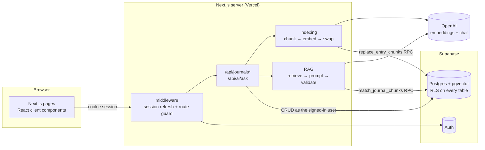

# ReflectAI — a private AI journal with RAG

ReflectAI is a multi-user journal. You write entries, then ask questions in plain language
("How did my interviews go?", "What have I been learning lately?"). Answers come **only
from your own entries**, and every claim links back to the entry it came from.

**Live demo:** _add your Vercel URL here_ · **Video walkthrough:** _add your video link here_

---

## Features

- **Email/password auth** (Supabase Auth): sign up, sign in, sign out, protected routes, durable cookie session.
- **Journal CRUD**: create, read, edit and delete entries with a title, date and body.
- **Automatic indexing**: each save chunks the entry, embeds the chunks with OpenAI and stores the vectors in pgvector. A status badge shows *Indexed / Indexing / Not indexed*, and there's a one-click retry.
- **Ask my journal (RAG)**: the question is embedded, the most similar chunks are retrieved *for this user only*, and a chat model answers from those chunks alone.
- **Clickable citations**: inline `[S1]` markers and source cards open the entry with the cited passage highlighted.
- **No made-up answers**: if nothing relevant is found, you get an "insufficient journal evidence" reply instead of generic advice.
- **Strict multi-tenancy**: Row Level Security on every table, `SECURITY INVOKER` database functions, and no service-role key anywhere in the app.
- **Cost control**: a per-user hourly cap on AI questions.
- Responsive on phone and desktop, follows the system light/dark setting, and the forms are keyboard- and screen-reader-friendly.

## Architecture



The app is one Next.js App Router project. The server routes are a thin layer that coordinates the work.
Every database call uses the **signed-in user's own session**, so Postgres RLS decides what
each request can see. The OpenAI key exists only on the server.

### Workflow A — saving an entry

1. The server verifies the session (`supabase.auth.getUser()`) and validates the payload with Zod.
2. The entry is written to `journal_entries`. `user_id` comes from `auth.uid()` in the database, never from the browser.
3. The text is split into overlapping chunks: ~2,000 characters each (≈500 tokens) with ~300 characters (≈75 tokens) of overlap, on sentence boundaries.
4. Each chunk is embedded with `text-embedding-3-small` (1,536 dimensions). The title and date are prepended so questions about dates and topics match.
5. `replace_entry_chunks()` deletes the old vectors and inserts the new ones **in one transaction**, and only if the entry hasn't been edited again in the meantime (an optimistic version check on `updated_at`).
   If OpenAI fails, nothing is deleted. The last working index stays in place and the entry is marked `failed` so it can be retried.

### Workflow B — asking a question

1. The server checks the session and the per-user quota (`consume_ai_quota()`).
2. The question is embedded with the same model.
3. `match_journal_chunks()` runs a cosine-similarity search **scoped to `auth.uid()`**, keeps chunks above a threshold, and returns the top-k (default 5) with title, date and entry ID.
4. If nothing qualifies, the server returns *insufficient evidence* without calling the chat model.
5. Otherwise the chunks are labelled `S1…Sn` and sent to `gpt-4.1-mini` with strict instructions: answer only from the excerpts, cite every claim, and say so if the excerpts don't answer the question. The reply is JSON.
6. The server **validates the citations**. Labels that weren't retrieved are dropped, and an answer with no valid citation becomes *insufficient evidence*. The client receives the answer plus source cards that link to the entries.

All journal entries are never sent to the model in bulk. Only the retrieved chunks are.

## Tech stack

| Layer | Choice | Why |
|---|---|---|
| Frontend + backend | Next.js 15 (App Router), TypeScript, React 19 | One deployable app; server routes keep secrets off the client |
| Styling | Tailwind CSS v4, lucide-react icons | Fast, consistent, responsive |
| Auth + DB | Supabase Auth + PostgreSQL | Managed auth, SQL migrations, Row Level Security |
| Vectors | pgvector on the same Postgres | Vectors sit next to the rows they index; one security model covers both |
| AI | OpenAI `text-embedding-3-small` + `gpt-4.1-mini` | Cheap, good-quality embeddings; small model is enough for grounded answers |
| Validation | Zod | Request shape and length limits on every endpoint |
| Tests | Vitest | Unit tests for chunking/citations; integration tests for RLS |
| Hosting | Vercel | Native Next.js deployment and environment config |

## Project structure

```
app/
  (auth)/login, (auth)/signup, (auth)/actions.ts   server actions for sign in/up/out
  (dashboard)/dashboard                           entry list
  (dashboard)/journal/new, journal/[id]           create / view / edit / delete
  (dashboard)/ask-ai                              Ask my journal
  api/journals, api/journals/[id], [id]/reindex   CRUD + retry indexing
  api/ai/ask                                      RAG endpoint
  auth/confirm                                    email-confirmation callback
components/  auth/, journal/, chat/
lib/
  ai/        chunking.ts embeddings.ts retrieval.ts rag.ts citations.ts openai.ts
  journal/   schema.ts (Zod + types), indexing.ts
  supabase/  server.ts client.ts middleware.ts
  api/http.ts                                     auth guard, JSON + error helpers
supabase/migrations/001_initial.sql               tables, RLS, RPCs, grants
scripts/seed-demo.ts                              fictional demo data for two accounts
tests/unit, tests/integration
```

## Setup

### Prerequisites

- Node.js 20+ (built and tested on Node 24)
- A Supabase project (the free tier is fine)
- An OpenAI API key

### 1. Install

```bash
git clone <this repo>
cd reflect-ai
npm install
cp .env.example .env.local     # then fill in the values
```

### 2. Environment variables

| Variable | Required | Where it's used | Notes |
|---|---|---|---|
| `NEXT_PUBLIC_SUPABASE_URL` | ✓ | browser + server | Supabase → Project Settings → API |
| `NEXT_PUBLIC_SUPABASE_PUBLISHABLE_KEY` | ✓ | browser + server | The publishable key (`sb_publishable_…`) or the legacy `anon` key. Safe to expose because RLS protects the data |
| `OPENAI_API_KEY` | ✓ | server only | Never prefix with `NEXT_PUBLIC_` |
| `OPENAI_CHAT_MODEL` | | server | Default `gpt-4.1-mini` |
| `OPENAI_EMBEDDING_MODEL` | | server | Default `text-embedding-3-small` (must return 1,536 dims) |
| `AI_ASK_LIMIT_PER_HOUR` | | server | Default `30` questions per user per hour |
| `RAG_MATCH_THRESHOLD` | | server | Default `0.25` cosine similarity |
| `RAG_MATCH_COUNT` | | server | Default `5` chunks (capped at 10 in SQL) |
| `TEST_USER_A_*`, `TEST_USER_B_*` | | seed + integration tests | Two throwaway accounts you create in the app |

The app never needs the Supabase **service-role** key. Don't add it.

### 3. Supabase

1. Create a project at [supabase.com](https://supabase.com).
2. Open **SQL Editor**, paste in [`supabase/migrations/001_initial.sql`](supabase/migrations/001_initial.sql) and run it. It enables `vector`, then creates the tables, RLS policies, functions and grants.
   (With the Supabase CLI: `supabase link` then `supabase db push`.)
3. **Authentication → Sign In / Providers → Email**: keep it enabled. Then either:
   - turn **Confirm email** off for a quick demo, or
   - leave it on and add `http://localhost:3000/auth/confirm` and `https://<your-domain>/auth/confirm` under **Authentication → URL Configuration → Redirect URLs**.
4. Copy the project URL and publishable key into `.env.local`.

### 4. Run

```bash
npm run dev            # http://localhost:3000
```

Optional demo data (fictional entries for two accounts):

```bash
# create two accounts in the app first, put their credentials in TEST_USER_A_* / TEST_USER_B_*
npm run seed
```

## API

All endpoints require a signed-in session cookie. Request bodies are JSON (`Content-Type: application/json` is enforced).

| Method | Endpoint | Does |
|---|---|---|
| `GET` | `/api/journals` | List the user's entries (newest first) |
| `POST` | `/api/journals` | Create `{ title, content, entry_date }` and index it → `201 { entry, indexing }` |
| `GET` | `/api/journals/:id` | Read one entry |
| `PATCH` | `/api/journals/:id` | Update any field and re-index → `{ entry, indexing }` |
| `DELETE` | `/api/journals/:id` | Delete the entry; its chunks cascade |
| `POST` | `/api/journals/:id/reindex` | Retry indexing after a failure |
| `POST` | `/api/ai/ask` | `{ question }` → `{ answer, sources[], grounded, retrievedCount }` |

| Status | Meaning |
|---|---|
| `400` | Validation failed (`details` lists the fields) |
| `401` | Not signed in |
| `404` | Entry doesn't exist **or belongs to someone else**. These are deliberately indistinguishable |
| `415` | Body isn't JSON |
| `429` | Hourly AI question limit reached |
| `502` | OpenAI unavailable. Stored entries are unaffected |

`indexing.status` is `ready`, `pending` (a newer edit is being indexed) or `failed`. A failed index still saves the entry.

## Authorization model

- **Identity** comes only from the verified Supabase session. The server never reads a `user_id` from the request.
- **RLS** is enabled on `journal_entries`, `journal_chunks` and `ai_requests`:
  - Entries: `SELECT/INSERT/UPDATE/DELETE` only where `auth.uid() = user_id`.
  - Chunks: readable and insertable only if the chunk's `user_id` **and** its parent entry's owner are `auth.uid()`. There's no update policy; chunks are only ever replaced.
  - A trigger stops `user_id` from ever being changed on update.
- **Functions** (`match_journal_chunks`, `replace_entry_chunks`, `consume_ai_quota`) are `SECURITY INVOKER` with an empty `search_path`. They run with the caller's rights, so RLS still applies, and they also filter on `auth.uid()` explicitly as a second check. `EXECUTE` is revoked from `anon`.
- **No service-role key** exists in the app, so no code path can bypass RLS.
- **CSRF**: mutating API routes require `application/json`, and Supabase cookies are `SameSite=Lax`.
- **Open redirects**: the `?next=` parameter on login is restricted to same-site relative paths.
- **Prompt injection**: excerpts are fenced and declared as data. Citations are validated server-side, so the model can't cite entries that weren't retrieved.

## Testing

```bash
npm test                    # unit: chunking + citation validation (no network)
npm run test:integration    # RLS / RPC isolation against your Supabase project
npm run typecheck
npm run build
```

The **integration suite** signs in as two real accounts and proves that:

- account B can't read, update or delete account A's entry by ID, or read its chunks;
- B's similarity search doesn't return A's chunk, even with an identical query vector;
- B can't write chunks into A's entry (neither via the RPC nor a direct insert);
- anonymous callers get nothing;
- re-indexing replaces the old vectors, superseded vectors disappear from search, and a stale embedding job can't overwrite a newer index;
- deleting an entry removes its vectors.

It uses synthetic vectors, so it needs no OpenAI key and the similarity scores are deterministic.

### Manual QA checklist

| Scenario | Expected |
|---|---|
| Sign up / in / out | Session starts and ends; `/dashboard` redirects to `/login` when signed out |
| Create, edit, delete | Changes persist across refresh; delete removes vectors |
| Grounded question | Answer cites `[S#]` and the source cards open the right entry with the passage highlighted |
| Unrelated question ("What's the capital of Peru?") | "I couldn't find anything in your journal…" |
| Cross-account ID (paste A's `/journal/<id>` while signed in as B) | "Entry not found" |
| Cross-account search (B asks "What do you know about Project Atlas?") | No evidence; A's secret isn't revealed |
| Edit then ask | New facts are found; removed facts aren't |
| Bad `OPENAI_API_KEY` | Entry saves with a *Not indexed* badge and a retry button; Ask shows a friendly error |

## Deployment (Vercel)

1. Push this repo to GitHub and import it in Vercel. The framework (Next.js) is auto-detected.
2. Add the environment variables from `.env.example` under **Settings → Environment Variables** (Production and Preview).
3. Deploy, then add `https://<your-app>.vercel.app/auth/confirm` to Supabase's redirect URLs and set it as the **Site URL**.
4. Smoke test on the live URL: sign up → create an entry → ask a question → open a citation → sign in as a second account and confirm the first account's data can't be seen.

`/api/ai/ask` sets `maxDuration = 60`. Indexing runs inline within the request, which is fine for entries up to the 20,000-character limit.

## Known trade-offs and next steps

- **Exact vector search, no ANN index.** Retrieval filters by `user_id` with a B-tree and then ranks exactly. At journal scale (hundreds or thousands of chunks per user) this is fast and avoids HNSW's post-filtering, which can silently drop results in multi-tenant tables. With a very large corpus, add an HNSW index and pgvector 0.8's iterative scans.
- **Indexing is synchronous.** It's simple and reliable for an MVP. A queue (Supabase Queues, Inngest) would make saves instant and retries automatic.
- **Character-based chunk sizing** (≈4 chars per token) avoids a tokenizer dependency. Swap in `tiktoken` if you need exact token counts.
- **The quota check isn't strictly atomic.** Truly concurrent requests can exceed the cap by a request or two. That's acceptable for a cost guard.
- **Chat history isn't persisted.** Q&A lives only in the current page session.
- **Not yet built:** OAuth providers, tags, mood analytics, streaming answers, hybrid (keyword + vector) search, and a reranking step.
- `npm audit` flags the PostCSS copy that Next 15 bundles for **build-time** CSS processing. It isn't reachable at runtime. The fix is Next 16.
